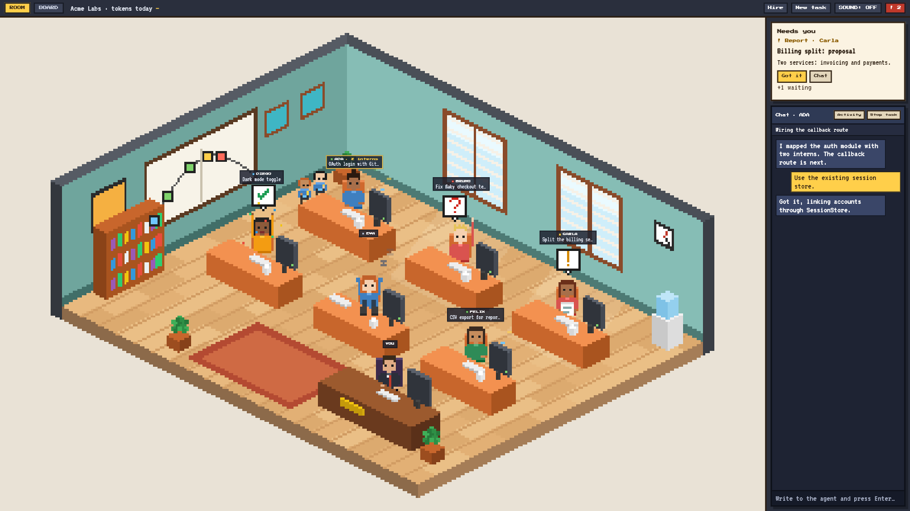
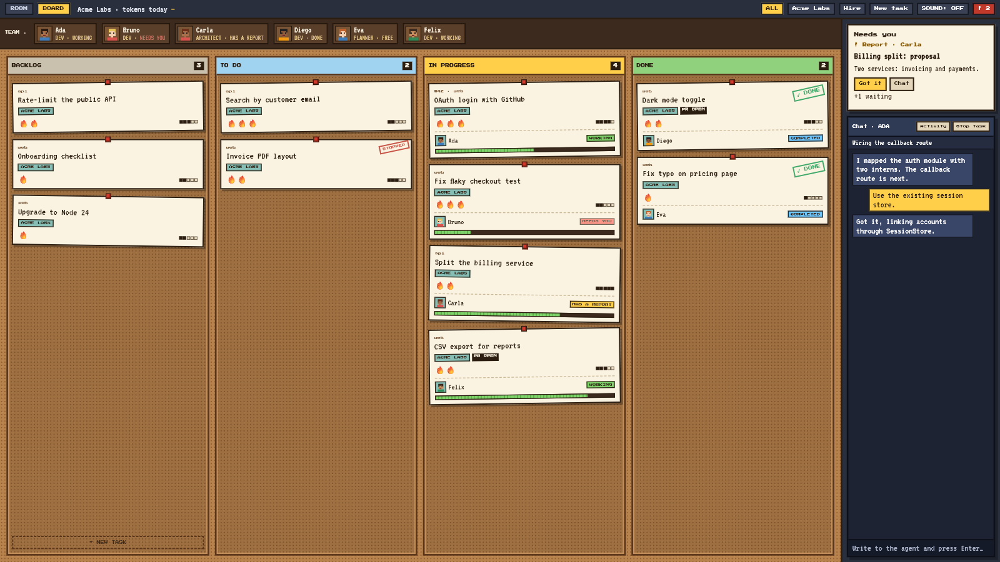
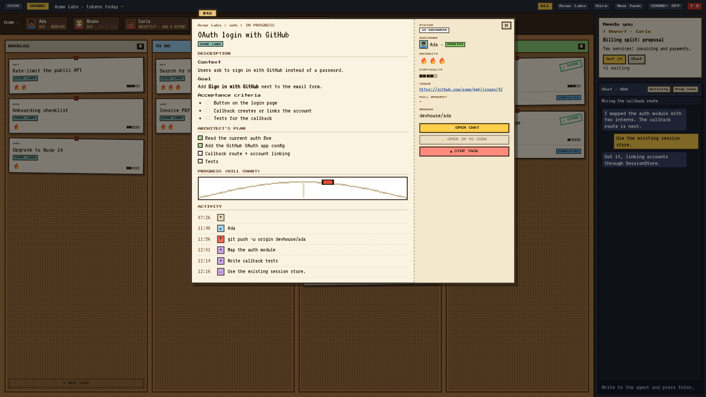

# AI Devhouse

**Your dev team is a bunch of AI agents. Now you can actually see them work.**

AI Devhouse is a desktop app that looks like a management game and runs a real software team. Each developer is a Claude Code agent with its own desk, its own git branch and its own worktree, working on your actual repositories. You hand out the work, answer questions when someone gets stuck, and review what comes back.

If you already run several coding agents at once, you know the routine: ten terminal tabs, three VS Code windows, and an agent that has been waiting for your answer for forty minutes because you didn't happen to look at its tab. Devhouse puts the whole team in one room. You can tell who is busy, who is done and who needs you from across the screen, and the app makes a sound when it's your turn.

  <a href="https://github.com/Vapulab/ai-devhouse-releases/releases/latest"><b>⬇️ Download the latest release</b></a>
  &nbsp;·&nbsp; Windows · macOS · Linux

---

## The office

Every agent sits at a desk, and you can read its state from its body language.

| Pose | What it means |
| --- | --- |
| Typing | Working on its task |
| Holding a paper | Has a report for you |
| Hand up, red "?" | Stuck, needs a decision or a permission |
| Arms up, confetti | Finished the task |
| Feet on the desk | Free for the next job |

When an agent splits its work into sub-agents, little interns show up next to its desk and leave when they're done. The whiteboard on the wall is a live hill chart: every task in progress is a dot, climbing while the agent is still working out the approach and sliding down once it's just execution.

A "Needs you" queue on the right lists everything waiting on you, oldest first. Click any agent to chat with it.

## The board

A cork board with four columns: Backlog, To do, In progress and Done. Dragging a card does real work: drop it on In progress, or right onto someone's face in the team strip, and that agent creates a branch and a worktree, opens a session and gets going. The last two columns follow what the agents are really doing, so you never tidy the board by hand.

## The task sheet

Click a card and it opens like a case file: the brief, the plan the agent wrote and ticks off as it goes, its spot on the hill, the pull request it opened, and a log of everything that happened.

## You stay in charge

- Agents ask before running anything outside the safe list you set per company. You can allow a command once, or always for that session.
- Git is limited to a short list of safe commands. Anything else comes to you first.
- Agents can't read `.env` files, keys or certificates.
- All work happens in separate worktrees. Your own checkout is never touched.
- Close the app in the middle of a task and the agent comes back marked as interrupted, ready to resume.

---

## Install

1. Install the [Claude Code CLI](https://docs.claude.com/en/docs/claude-code) and log in. Devhouse runs your agents through it.
2. Download the installer for your system from the [latest release](https://github.com/Vapulab/ai-devhouse-releases/releases/latest):

| System | File |
| --- | --- |
| Windows | `.msi` or `-setup.exe` |
| macOS (Apple Silicon) | `aarch64.dmg` |
| macOS (Intel) | `x64.dmg` |
| Linux | `.AppImage`, `.deb` or `.rpm` |

### First launch

The builds are not signed yet, so your system will warn you the first time:

- **Windows:** on "Windows protected your PC", click **More info → Run anyway**.
- **macOS:** if it says the app is damaged or can't be opened, run `xattr -cr "/Applications/AI Devhouse.app"` once, then open it again.

## Status

A working proof of concept. Working now: the office, the board, the task sheet, hiring agents and running tasks with Claude Code in isolated worktrees, permission prompts, secret protection, resuming interrupted sessions, and English and Portuguese (pt-BR).

Coming next: GitHub issue and Notion import, planner and architect roles, the full pull request loop, engines other than Claude Code, and Steam.

## Feedback

Found a bug or have an idea? [Open an issue](https://github.com/Vapulab/ai-devhouse-releases/issues/new/choose). The source code is private for now; this repository holds the releases, the screenshots and the issue tracker.

---

A <a href="https://vapulab.com">VapuLab</a> project · made by <a href="https://github.com/darkanum">@darkanum</a>

